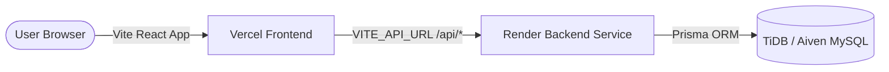

# 🚀 DevFlow Deployment Guide: Vercel + Render

Complete step-by-step guide to deploying **DevFlow** for free with CLI and Git workflows.

---

## 🏗️ Architecture Overview



| Component | Platform | Configuration File | Command Line Tool |
|---|---|---|---|
| **Frontend** | [Vercel](https://vercel.com) | [client/vercel.json](file:///client/vercel.json) | `vercel` |
| **Backend** | [Render](https://render.com) | [render.yaml](file:///render.yaml) | `render` |
| **Database** | [TiDB Cloud](https://tidbcloud.com) or [Aiven](https://aiven.io) | [server/prisma/schema.prisma](file:///server/prisma/schema.prisma) | `prisma` |

---

## 🗄️ Step 1: Provision Free MySQL Database

Before starting the backend, get a free MySQL connection string.

### Option A: TiDB Cloud Serverless (Recommended — 25 GB Free Forever)
1. Sign up at [tidbcloud.com](https://tidbcloud.com) (no credit card needed).
2. Create a free **Serverless Cluster**.
3. Under **Connection**, select **Prisma** or **General** and copy your connection string:
   ```env
   DATABASE_URL="mysql://<username>:<password>@<host>:4000/<dbname>?sslaccept=strict"
   ```

### Push Schema & Seed Initial Data:
From your local terminal, apply the schema to your cloud database:
```bash
# In devflow/server, set your temporary cloud DATABASE_URL:
npx prisma db push --schema=prisma/schema.prisma

# Seed initial Alice demo user and projects
npm run db:seed
```

---

## ⚙️ Step 2: Deploy Backend to Render

Render will run your Express Node.js backend using the pre-configured [render.yaml](file:///render.yaml) blueprint.

### Method A: Via Git / Render Dashboard (Recommended)
1. Push your latest code to your GitHub repository:
   ```bash
   git add .
   git commit -m "Configure Vercel and Render deployment"
   git push origin main
   ```
2. Go to [dashboard.render.com](https://dashboard.render.com).
3. Click **New +** ➜ **Blueprint** (or **Web Service**).
4. Select your `devflow` repository. Render will automatically read [render.yaml](file:///render.yaml).
5. Fill in the required environment variables:
   - `DATABASE_URL`: Your cloud MySQL string from Step 1.
   - `CORS_ORIGIN`: Your frontend URL (e.g. `https://devflow-client.vercel.app` or leave empty initially; Render automatically allows `*.vercel.app`).
   - `NODE_ENV`: `production`
6. Click **Apply**.
7. Once deployed, copy your backend URL (e.g. `https://devflow-api.onrender.com`).

### Method B: Via Render CLI
```bash
# If using Render CLI
render login
render blueprint launch
```

---

## ⚡ Step 3: Deploy Frontend to Vercel

### Method A: Via Vercel CLI (Fastest)

1. Install the Vercel CLI globally (if not already installed):
   ```bash
   npm install -g vercel
   ```

2. Login to your Vercel account:
   ```bash
   vercel login
   ```

3. Deploy from the `client` directory:
   ```bash
   cd client
   vercel
   ```
   Follow the prompts:
   - Set up and deploy `client`? **Y**
   - Which scope? *(Select your account)*
   - Link to existing project? **N**
   - Project name: `devflow`
   - In which directory is your code located? `./`
   - Auto-detected framework: **Vite**
   - Want to modify settings? **N**

4. Add your Render backend URL to Vercel:
   ```bash
   vercel env add VITE_API_URL production
   # When prompted, paste your Render URL: https://devflow-api.onrender.com
   ```

5. Deploy directly to production:
   ```bash
   vercel --prod
   ```

### Method B: Via Vercel Dashboard (Connected to GitHub)
1. Go to [vercel.com/new](https://vercel.com/new).
2. Import your GitHub repository.
3. Configure the project:
   - **Framework Preset**: Vite
   - **Root Directory**: `client`
   - **Build Command**: `npm run build`
   - **Output Directory**: `dist`
4. Expand **Environment Variables** and add:
   - **Name**: `VITE_API_URL`
   - **Value**: `https://your-backend.onrender.com`
5. Click **Deploy**.

---

## 🔄 Step 4: Final Link Verification

1. In Render, update `CORS_ORIGIN` with your Vercel URL (e.g. `https://devflow.vercel.app`).
2. Visit your Vercel URL in your browser.
3. Open Developer Tools (F12) ➜ Network tab:
   - Verify calls to `/api/health`, `/api/auth/login`, and `/api/projects` return `200 OK` from your Render service.
4. Test logging in with the demo account:
   - **Email**: `alice@devflow.io`
   - **Password**: `password123`
   - Or test creating a new user to experience the full onboarding flow!

---

## 🛠️ CLI Quick Reference

```bash
# Local testing of production build
npm run build
npm --workspace=server run start

# Vercel preview deployment
cd client && vercel

# Vercel production deployment
cd client && vercel --prod

# Check database schema synchronization
npm --workspace=server run prisma:push
```
